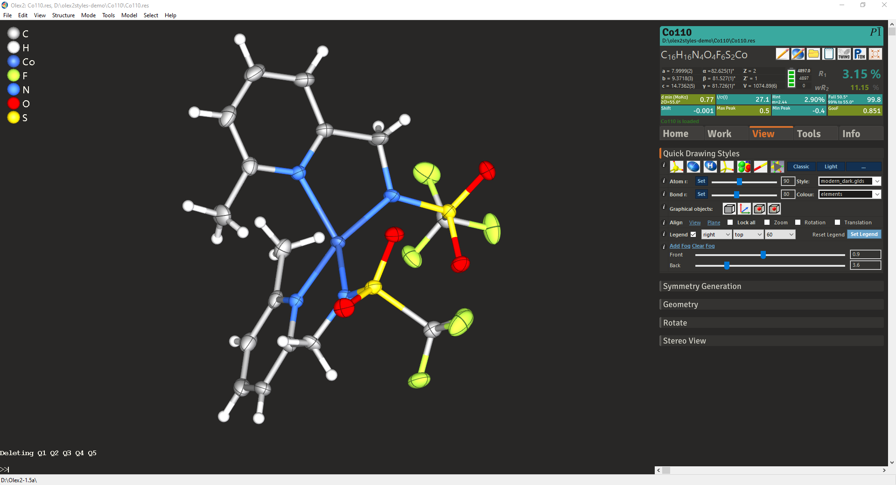

# Flexoki for Olex2

Flexoki 3D drawing styles and GUI skins for [Olex2](https://www.olexsys.org).



## Install

1. Copy the `etc/` folder into your Olex2 installation folder (the one with `olex2.exe`), merging it with the existing `etc/styles` and `etc/skins`.
2. In Olex2's command line, pick a skin and its matching 3D style:

   ```
   skin flexokidark
   load style flexoki_dark
   ```

Reload the structure after switching skins, or the results grid stays hidden.

| Skins | 3D style |
|---|---|
| `flexokilight`, `flexokilightmagenta`, `flexokilightpurple`, `flexokilightcyan`, `flexokilightblue` | `flexoki_light` |
| `flexokidark`, `flexokidarkmagenta`, `flexokidarkpurple`, `flexokidarkcyan`, `flexokidarkblue` | `flexoki_dark` |

The plain names use the orange accent and the others swap it. Panels use base-100 or base-900, cards base-50 or base-850, and accents the 600 shades in light and the 400 shades in dark.

## Notes

- Generated by `build_modern.py` in [olex2styles](https://github.com/Yluro/olex2styles/tree/master); edit the palette there, not these files.
- The `.glds`/`.glsp` styles are derived from Olex2's own `light_g` style; Olex2's terms (`licence.rtf` in your Olex2 installation) apply to them.
- Tested with Olex2 1.5 on Windows 10. Combo boxes, checkboxes, slider thumbs and the green status line are drawn by Olex2 or Windows and ignore the skin.